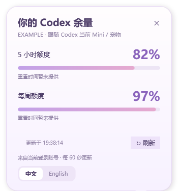
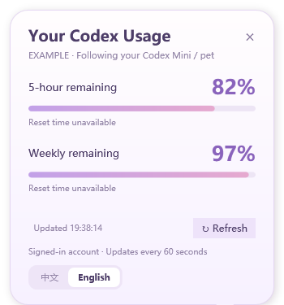

# Codex Mini Quota · Mini 用量气泡

点击 Codex 官方 Mini 宠物，查看 **5 小时与每周剩余额度**。

支持中文和 English，随 Codex 启动加载，在首页即可使用，无需新建聊天、单独启动助手或设置 Windows 登录自启动。

> 第三方 Windows 本地扩展，与 OpenAI 无隶属关系。显示的是 Codex 使用额度，不是 API 美元余额或 ChatGPT 聊天额度；可显示的额度窗口以账号接口返回为准。

## 预览

| 简体中文 | English |
| --- | --- |
|  |  |

## 功能

- 点击官方 Mini 宠物展开余量气泡，保留宠物原有点击行为。
- 显示剩余百分比与重置时间，每 60 秒自动刷新，也可手动刷新。
- 点击「中文」「English」立即切换语言，并保存偏好。
- 支持通过托盘菜单恢复自动跟随 Codex / Windows 语言。
- 随客户端启动加载，完全退出 Codex 后约 12 秒内退出。
- 支持重新安装、旧安装目录迁移和卸载时还原启动设置。

接口未提供的额度显示「暂未提供」，不会推算为 0% 或 100%。

## 环境要求

- Windows x64，已安装并登录 Codex 桌面客户端，开启官方 Mini / 宠物。
- Windows Explorer、Windows PowerShell、.NET Framework 4.x / WPF。
- 支持 `plugin` 子命令的 Codex CLI，安装脚本会自动查找，无需手动配置 Codex PATH。
- Python 3.11+，优先使用 Codex 配套运行环境中的 Python，其次使用 PATH 中的 `python`。

当前窗口识别针对 `WindowsApps\OpenAI.Codex_…` 官方安装布局。macOS、Linux 和其他安装布局尚未适配，客户端更新可能需要兼容调整。

## 安装

1. 完整解压到准备长期保留的文件夹，不要在 ZIP 内执行。
2. 双击 `install.cmd`。
3. 安装成功后，完全退出并重启 Codex。

保留整个解压目录。`.cmd` 会调用配套的 PowerShell 和 Python 文件，不能只保留 CMD 或删除 PS1。仓库保留完整开发源码、测试和构建脚本，供检查、修改和自行编译。

升级时从新解压目录运行 `install.cmd`，确认安装及来源迁移成功后，再清理旧目录。

### 启动检查设置

安装会启用：

```toml
[desktop]
mcp_startup_authentication = true
```

**这是全局 MCP 启动检查开关。** 其他已启用的 MCP 服务也可能在启动阶段连接、增加初始化时间或要求登录。安装脚本会保存该设置的原值，卸载时可选择还原。

配置目录优先使用 `CODEX_HOME`，否则为 `%USERPROFILE%\.codex`。安装、运行和卸载应使用同一 Windows 用户及配置目录。

## 使用

| 操作 | 方式 |
| --- | --- |
| 查看余量 | 点击官方 Mini 宠物 |
| 手动刷新 | 点击「刷新 / Refresh」 |
| 切换语言 | 点击气泡底部「中文」或「English」 |
| 自动语言 | 托盘菜单 →「中文 / English」→「自动 / Auto」 |
| 收起气泡 | 点击关闭按钮或按 `Esc` |
| 退出助手 | 在托盘菜单选择退出；再次加载需完全退出并重启 Codex |

仅关闭主窗口而让 Codex 留在后台，可能不会重新触发加载。

## 卸载

双击 `uninstall.cmd`，按 `1` 仅卸载，按 `2` 卸载并还原原设置，按 `0` 取消。

建议卸载前完全退出 Codex。卸载器会释放本插件的缓存占用，清理插件及本项目来源注册，不会结束 Codex 客户端或其他插件。还原按保存的原值处理；用户后来修改过该开关或没有还原记录时，不自动覆盖。

卸载后保留语言偏好、诊断与设置还原记录。确认卸载成功且无需再操作后，可删除解压目录。

## 常见问题

- **点击宠物没气泡：** 确认 Mini 可见、插件启用，并且安装后已经完全退出并重启 Codex。检查全局 MCP 启动检查是否开启。
- **额度缺失或读取失败：** 检查 Codex 登录状态与网络，再点击刷新。接口未提供的窗口无法补齐。
- **安装或卸载报错：** 保留完整错误信息。ZIP 用户先确认完整解压、未删除依赖；文件拒绝访问时完全退出 Codex 及占用程序后重试。

更多操作与排错说明见 [使用说明](使用说明.md)，版本变化见 [CHANGELOG](CHANGELOG.md)。

## 工作原理与隐私

客户端 MCP 启动检查初始化 `QuotaBootstrap.exe`，通过桌面 Explorer 启动气泡组件 `MiniQuota.exe`。组件识别官方宠物点击，通过本地 Codex app-server 的 `account/rateLimits/read` 查询额度，不创建聊天或发起模型生成。

项目不修改 `WindowsApps` 或 `app.asar`，无自建遥测或上传服务。额度查询仍使用当前登录账号连接 Codex 服务，运行期间会增加本地进程与定时查询开销。

语言偏好、启动设置还原记录和脱敏诊断保存在 `%LOCALAPPDATA%\CodexMiniQuota`。诊断不记录原始接口响应、密钥或对话。多屏缩放、多个候选窗口或客户端界面变化可能影响宠物识别。

## 源码构建

在完整源码目录中运行：

```powershell
# 构建插件程序
powershell -NoProfile -ExecutionPolicy Bypass -File .\plugins\mini-quota\source\build.ps1

# 运行自动检查
powershell -NoProfile -ExecutionPolicy Bypass -File .\tests\run.ps1
```

使用系统 .NET Framework C# 编译器，无需 npm。源码修改后需重新构建、安装并重启 Codex。

## English

**Codex Mini Quota** is a third-party Windows companion that shows your remaining Codex usage when you click the official Mini pet. It supports Chinese and English, refreshes every 60 seconds, and loads with Codex without opening a chat or adding a Windows logon task.

**Install:** download or clone the full project, extract if needed, and double-click **install.cmd**. Fully quit and reopen Codex, enable Mini, and click the pet. Keep the project folder, including the PS1 and Python files required by the CMD launchers. Source code, tests and build scripts are included for inspection and modification.

Requires Windows x64, a signed-in Codex desktop client, Explorer, Windows PowerShell, .NET Framework 4.x / WPF, a CLI with plugin support, and Python 3.11+. Setup automatically locates the CLI and prefers Codex's bundled Python.

Setup enables **global MCP startup checks**. Other enabled services may also connect or request authentication. Use the same Windows user and `CODEX_HOME` as the client.

**Uninstall:** double-click **uninstall.cmd**, then choose **1** to preserve the global startup setting, **2** to restore its saved value, or **0** to cancel. Preferences, diagnostics and restoration records remain after removal.

Usage queries do not initiate model generation. There is no custom telemetry service, but queries connect to Codex services using the current account. Unavailable usage windows are not estimated. Client updates or different installation/display layouts may require changes. This project is not affiliated with OpenAI.
